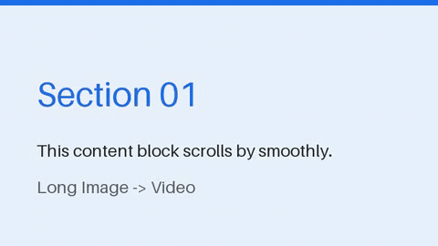

# 长图转视频（Long Image to Video）

[](https://github.com/LLL-404/long-image-to-video/actions/workflows/ci.yml)
[](https://www.python.org/)
[](LICENSE)

把一张或多张长截图纵向拼接成平滑滚动的 MP4 视频，自动检测 GPU 硬件加速编码，附桌面 GUI。

<p align="center">
  
</p>

English documentation: [README.md](README.md)。

上万像素的长截图没法直接分享？丢进来，得到一个匀速滚动播放完的视频——适合聊天记录、文章截图、代码长图、信息流内容。

## 功能特点

- **单图或多图拼接**：多张图片纵向拼接后整体滚动（自动处理 EXIF 方向与透明通道）
- **平滑缓动**：`linear` / `ease-in-out` / `ease-in-out-quad` / `ease-in-out-sine` 四种滚动曲线，代替匀速硬滚
- **GPU 硬件加速**：自动检测 NVIDIA NVENC / Intel QSV / AMD AMF；无 GPU 或超出编码限制时自动回退 CPU（OpenCV）
- **输出参数全可控**：视频宽度（360–3840）、宽高比（16:9 / 9:16 / 3:4 / 1:1 / 4:3 / 21:9）、帧率、滚动时长、x264 速度档位
- **桌面 GUI**：图片列表可排序、实时进度、支持中途取消
- **Python API**：转换核心可直接导入，方便脚本化与自动化

## 环境要求

- Python **3.10+**
- **FFmpeg** 已加入 `PATH`（运行时自动检测，用于管道编码）

## 安装

```bash
git clone https://github.com/LLL-404/long-image-to-video.git
cd long-image-to-video
pip install .
```

或免安装直接运行 GUI：

```bash
pip install -r requirements.txt
python main_gui.py
```

## 使用方法

### GUI

```bash
long-image-to-video        # pip 安装后可用
python main_gui.py         # 仓库根目录直接运行
```

1. 添加一张或多张图片，调整拼接顺序
2. 选择输出目录并设置参数（宽度、宽高比、帧率、时长、编码档位、滚动曲线）
3. 开始转换，实时显示进度，可随时取消

### Python API

```python
from pathlib import Path
from converter import generate_multi_scroll_video

out = generate_multi_scroll_video(
    image_paths=[Path("screen-1.png"), Path("screen-2.png")],
    output_dir=Path("./outputs"),
    video_width=1080,
    fps=30,
    scroll_duration=10.0,
    aspect_ratio="16:9",
    preset="medium",
    easing="ease-in-out",
)
print(f"已保存到 {out}")
```

## 参数说明

| 参数 | 范围 | 默认值 | 说明 |
|------|------|--------|------|
| `video_width` | 360–3840 | 1080 | 输出视频宽度（px），奇数会向下取偶 |
| `aspect_ratio` | 16:9, 9:16, 3:4, 1:1, 4:3, 21:9 | 16:9 | 视口宽高比 |
| `fps` | 1–60 | 30 | 帧率（推荐 24 / 30 / 60） |
| `scroll_duration` | 1–300 秒 | 10 | 滚动完整张图所需时间 |
| `preset` | ultrafast … veryslow | medium | 编码速度档位，越慢压缩率越高 |
| `easing` | 见上方列表 | ease-in-out | 滚动缓动曲线 |

## 编码流程

1. 图片在线程池中并发加载（EXIF 转正、透明通道压平、缩放到目标宽度），纵向拼接。
2. 按缓动曲线生成每帧的滚动偏移。
3. 帧流式送入编码器——全程不会把整张长图转成 numpy 数组，超长图也不会爆内存。
4. 优先使用检测到的 GPU 编码器（NVENC / QSV / AMF）；分辨率超限（高 > 4096 或宏块 > 36864）时先尝试降分辨率（≤30%），否则回退 CPU 编码。

## 开发

```bash
pip install -r requirements-dev.txt
python -m pytest     # 运行测试
ruff check .         # 代码检查
```

## 贡献

欢迎提交 Issue 和 Pull Request。较大的改动请先开 Issue 讨论。

## 许可证

[MIT](LICENSE) © 2026 LLL-404
